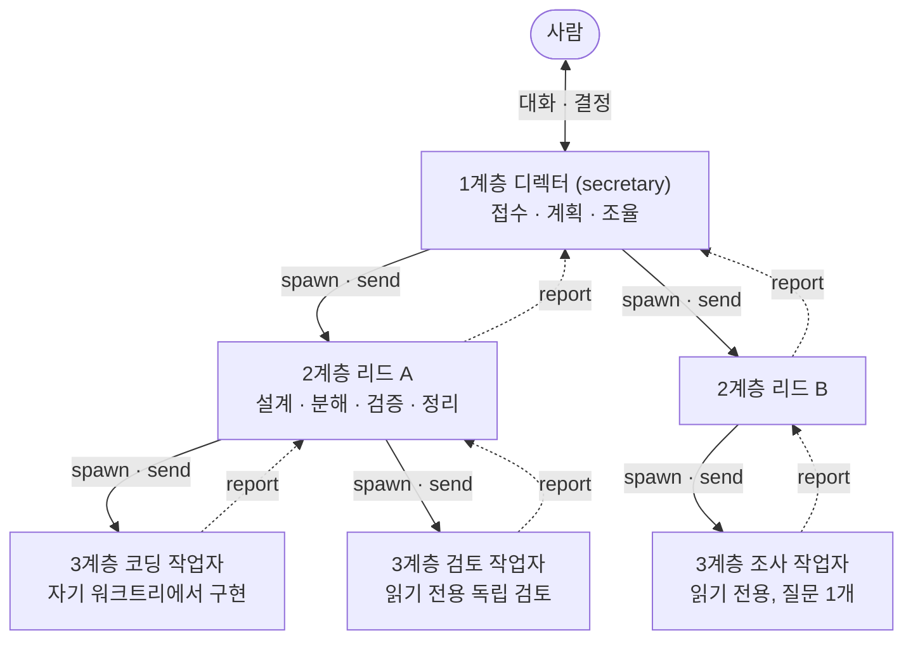

# 04. 세션 계층 체계도

작업대는 세션을 3계층으로 나눈다. 1계층은 디렉터 1개, 2계층은 큰 작업마다 여는 리드, 3계층은 리드가 여는 작업자다. 사람은 주로 디렉터와 대화하고, 필요하면 리드에게 직접 말한다. 작업자는 리드가 다룬다.

## 1. 한눈에 보기

실선은 세션 열기(`spawn`)와 후속 지시(`send`), 점선은 보고(`report`)다.



Herdr의 세션 트리에서는 대략 이렇게 보인다. 이름과 모델은 예시다. 실제 줄에는 세션을 연 폴더 이름도 붙는다.

```text
디렉터                claude-opus-5-5
├─ 리드 A             claude-opus-5-5     안 읽은 보고 1
│  ├─ 코딩 작업자      gpt-6.1-sol
│  └─ 검토 작업자      claude-sonnet-5-5
└─ 리드 B             gpt-6.1-sol
   └─ 조사 작업자      gpt-6.1-terra
```

## 2. 왜 3계층으로 나누는가

큰 작업 세션 2~3개를 사람이 동시에 돌리면, 한 세션의 결과를 요약해 다른 세션에 옮기고 순서를 맞추는 일이 사람에게 쌓인다. Codex까지 함께 쓰면 그 일이 더 늘어난다. 작업대는 맨 위에 전체 맥락을 가진 세션 1개(디렉터)를 두고, 전달과 조율을 계층이 맡게 한다.

계층마다 답하는 질문이 다르다.

- **디렉터**는 왜와 무엇을 다룬다. 사람의 요청을 목적과 완료 조건으로 정리하고, 사람과 우선순위를 정한다.
- **리드**는 어떻게를 다룬다. 작업 1개를 설계하고 나누고, 결과를 직접 검증하고, 끝나면 정리한다.
- **작업자**는 실행을 맡는다. 구현, 검토, 조사 중 좁은 일 1개를 한다.

세션마다 대화 맥락이 따로 있어서, 작업자는 자기 일 1개만, 리드는 작업 1개 전체를, 디렉터는 모든 작업의 상태를 안다. 사람은 디렉터와 리드의 2개 층만 보면 된다. 작업자가 답을 기다리거나 안 읽은 보고가 있으면 그 표시가 부모 리드 줄에도 보인다.

## 3. 계층별 책임

| 항목 | 1계층 디렉터 | 2계층 리드 | 3계층 작업자 |
|---|---|---|---|
| 역할 id | `secretary` | `lead` | `worker-code`, `worker-review`, `worker-query` |
| 누가 여는가 | 사람이 Herdr 터미널에서 | 디렉터만 | 리드만 |
| 개수 | 동시에 1개 | 큰 작업마다 1개 | 리드당 동시 3개 이내 |
| 하는 일 | 접수, 목적·완료 조건 정리, 사람과 우선순위 결정, 리드 열기, 보고 모으기, 판단에 필요한 맥락 설명 | 설계, 분해, 작업자 열기, 결과 직접 검증, 작업자 정리, 디렉터에게 보고. 작은 일은 혼자 한다 | 맡은 일 1개를 하고 근거와 함께 보고 |
| 하지 않는 일 | 작업자를 직접 열기, 사람 대신 결정, 남의 PR 머지, main 직접 커밋 | 첫 지시에 없는 일 맡기(디렉터에게 돌려보낸다), main 체크아웃에서 수정, 작업자 주장만으로 완료 판정 | 자식 열기, 자기 브랜치·워크트리 삭제, 게시·머지, 부모 대신 결정 |
| 작업 위치 | 디렉터가 일할 폴더(`bench.yaml`의 `cwd`) | 코드를 바꾸면 자기 워크트리(`--worktree`), 읽기·조율만 하면 `--cwd` | 코딩은 자기 워크트리, 검토·조사는 `--cwd` |
| 기본 벤더 | Claude | Claude | Codex |
| Codex로 열 때 샌드박스 | 읽기 전용 | 작업 폴더 쓰기 | 코딩은 작업 폴더 쓰기, 검토·조사는 읽기 전용 |
| 보고 대상 | 사람(채팅으로 답한다) | 디렉터 | 자기를 연 리드 |
| 정리하는 쪽 | 사람 | 디렉터(`close`) | 리드(`close`) |

작업자 3종은 이렇게 다르다.

| 종류 | 하는 일 | 보고에 넣는 것 |
|---|---|---|
| 코딩 작업자 | 자기 워크트리에서 구현한다. 기능·버그 수정은 실패하는 테스트를 먼저 확인한다. 커밋·push는 지시와 정책이 허용할 때만 한다 | 완료 조건별 충족 여부, 변경 파일, 검증 명령과 결과, 브랜치·커밋·push 여부 |
| 검토 작업자 | 설계·코드·초안을 독립 검토한다. 가능하면 작성자와 다른 벤더로 연다 | 판정(그대로 진행 / 수정 후 진행 / 다시 설계)과 이유, 발견마다 파일:줄 근거 |
| 조사 작업자 | 질문 1개에 근거로 답한다 | 결론, 확인한 사실과 출처(파일:줄, 명령 출력, URL), 확인하지 못한 범위 |

모델은 강점과 구독 사용량을 보고 고른다. 디렉터는 Claude 상위 모델을 쓴다. 리드와 작업자는 Claude와 Codex를 나눠 쓴다. 원인을 모르는 진단이나 여러 문서를 대조하는 조사처럼 어려운 일에는 상위 모델을 고른다. 모델 예시 표는 [역할 지시문](../reference/roles/lead.md)의 '모델 선택'에 있다.

## 4. 도구가 막는 것과 지시문이 정하는 것

bench는 세션 기록을 관리하는 도구이고 정책 엔진이 아니다. 아래 규칙 중 일부만 bench가 거절하고, 나머지는 역할 지시문과 정책 파일을 에이전트가 지켜서 유지된다.

| 규칙 | 지키게 하는 곳 |
|---|---|
| 디렉터는 동시에 1개만 활성 | bench가 거절한다 |
| 리드는 디렉터만, 작업자는 리드만 연다 | bench가 거절한다 |
| `send`는 등록된 부모가 자기 자식에게만 보낸다 | bench가 거절한다 |
| `report`는 등록된 부모의 수신함으로만 간다. 디렉터는 부모가 없어 사람에게 답한다 | bench가 대상을 정한다 |
| `close`는 등록된 부모만 하고, 그 아래 자식이 먼저 닫혀 있어야 한다 | bench가 거절한다 |
| 작업자 브랜치 삭제는 정책의 `own-merged-branch-cleanup` 규칙과 조건 4개가 맞을 때만 | bench가 정책 파일을 확인한다 |
| 자식 환경에서 `ANTHROPIC_API_KEY`·`OPENAI_API_KEY` 제거, Codex 샌드박스와 승인 방식(on-request) | bench가 실행 인자로 정한다 |
| 리드당 동시 작업자 3개 이내 | 정책 파일과 지시문. bench는 세지 않는다 |
| 검토 왕복이 2회를 넘으면 리드가 디렉터에게 보고 | 리드 지시문 |
| 되돌릴 수 없는 일(배포, force-push, 삭제, 외부 공유)은 사람 승인 뒤 | 정책 파일의 `report` 목록 |
| 승인 창과 trust 질문 | 사람만 답한다. 어떤 계층도 대신 답하지 않는다 |

## 5. 한 작업이 흐르는 순서

1. 사람이 디렉터에게 일을 맡긴다.
2. 디렉터가 목적과 완료 조건을 정리하고, 범위와 순서를 사람과 정한다.
3. 디렉터가 리드를 연다. 지시에는 배경, 작업 1개, 허용 경로, 완료 조건, 보고 근거, 모델 선택 이유를 넣는다.
4. 리드가 계획을 세우고 필요한 작업자만 연다. 작업자 지시에는 배경, 작업 1개, 파일 범위, 완료 조건, 검증 명령, 결과 경로를 넣는다.
5. 작업자가 리드에게 보고한다. 리드는 파일과 테스트 결과를 직접 확인하고, 끝난 작업자를 `close`한다.
6. 리드가 결론, 변경 경로, 실제 검증 명령과 결과, 남은 일, 자식·브랜치 정리 결과를 디렉터에게 보고한다.
7. 디렉터가 근거를 확인하고 보고를 `ack`한 뒤 사람에게 설명한다. 판단이 필요하면 선택지와 추천 근거를 붙인다.
8. 사람이 결정하면 디렉터가 리드를 `close`한다.

사람이 끼는 곳은 일을 맡기고 범위를 정할 때(1~2단계), 결과를 보고 결정할 때(7~8단계), 되돌릴 수 없는 일을 승인할 때, 승인 창에 답할 때다. 사람이 리드에게 직접 새 일을 맡기면 리드는 시작 전에 그 사실을 디렉터에게 보고한다.

## 6. 보고와 수신함

보고는 수신함 파일에 저장된다. 부모 화면에 자동으로 입력되지는 않으므로, 부모는 `wait`나 `inbox`로 확인한다. 부모는 근거를 확인한 뒤 실제 보고 ID로 `ack`한다. `--complete`는 맡은 일이 끝났다는 표시이고, 내용 승인이나 결함이 없다는 선언이 아니다. 보고 1개는 16,000자까지이고, 긴 내용은 결과 파일에 두고 절대 경로를 적는다. Codex 세션은 보고 전용 MCP 도구(`bench_report`, `bench_inbox`, `bench_ack`)로 같은 일을 한다.

보고 순서는 결론 → 끝난 것과 근거 → 진행 중인 것 → 막힌 이유와 필요한 판단이다. 수신함 파일을 손으로 고쳐 보고·승인·완료를 만들지 않는다.

## 7. 정리와 복구

정리는 아래에서 위로 한다. 리드가 작업자를 닫고, 디렉터가 리드를 닫는다. `close`는 세션 종료 → 변경·미push 확인 → 워크트리 제거 → 정책 조건 확인 → `git branch -d` 순서로 처리한다. 브랜치는 작업대가 만든 브랜치이고, origin/main에 머지됐고, 변경과 미push 커밋이 없고, 로컬 브랜치일 때만 지운다. 하나라도 맞지 않으면 남기고 이유를 보고한다. 실행 전에 실패한 spawn이 남긴 워크트리는 `discard`로 정리한다.

컴퓨터를 다시 켜서 세션이 모두 끝났으면 `recover --dry-run`으로 미리 보고 실행한다. recover는 위에서부터 하나씩 다시 연다. 같은 주소에 셸이 남아 있으면 그 주소에서 같은 대화로 다시 띄우고, 터미널이 사라졌으면 새 터미널이 그 자리를 이어받는다. 어느 쪽이든 부모·자식 관계와 워크트리, 수신함은 이어진다. 세션 1개만 끊겼으면 `takeover`로 새 터미널이 그 자리를 이어받는다. 디렉터는 아무 터미널에서, 그 아래는 등록된 부모만 이어받을 수 있다. 자세한 조건은 [bench README](../reference/workbench/README.md)의 '재부팅 뒤 할 일'과 '끊긴 세션 이어받기'에 있다.
